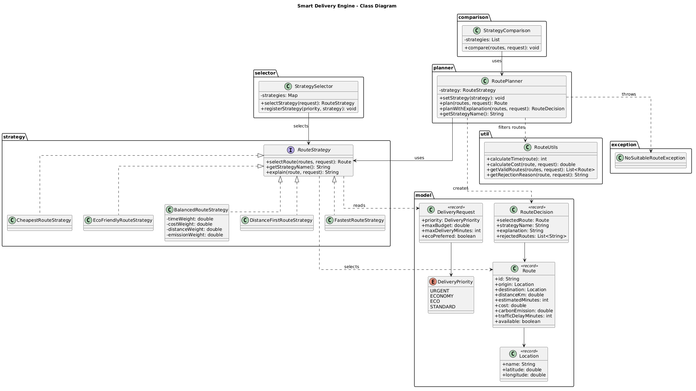
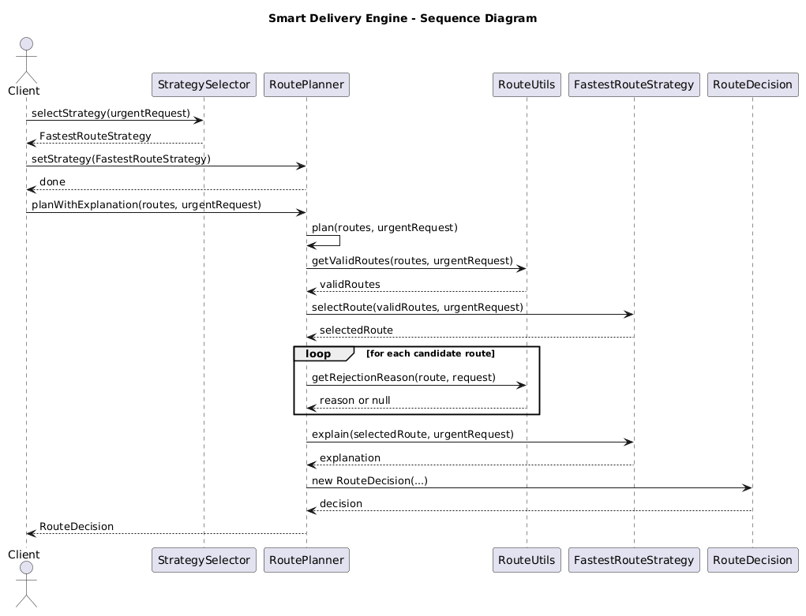

# Smart Delivery & Route Optimization Engine

**Assignment 5 — Strategy Pattern**

**Student:** Zhumabay Akmaral  
**Group:** SE-2517  
**Course:** Software Design  
**Language:** Java 17+  
**Build Tool:** Maven  
**Testing:** JUnit 5

## 1. Project Overview

The Smart Delivery & Route Optimization Engine is a Java application that selects suitable delivery routes based on different optimization criteria.

The project demonstrates the **Strategy Design Pattern**, allowing route-selection algorithms to be changed at runtime without modifying the main route-planning logic.

The system supports five strategies:

- **FastestRouteStrategy** — selects the route with the shortest delivery time, including traffic delays.
- **CheapestRouteStrategy** — selects the route with the lowest calculated delivery cost.
- **EcoFriendlyRouteStrategy** — selects the route with the lowest environmental score.
- **BalancedRouteStrategy** — selects a route using configurable weights for time, cost, distance, and emissions.
- **DistanceFirstRouteStrategy** — selects the route with the shortest distance.

The application also supports automatic strategy selection, route restrictions, comparison mode, explanations, and failure handling.

## 2. Architecture

The project uses three main components:

**Context — RoutePlanner**

`RoutePlanner` manages the current strategy, filters routes using hard constraints, and delegates route selection to the chosen strategy.

**Strategy Interface — RouteStrategy**

`RouteStrategy` defines the common methods:

- `selectRoute()` — selects the best route.
- `getStrategyName()` — returns the strategy name.
- `explain()` — explains the selected result.

**Concrete Strategies**

Each concrete strategy implements `RouteStrategy` and provides its own selection algorithm.

Additional components include:

- `StrategySelector` — automatically chooses a strategy based on delivery priority and eco preference.
- `RouteUtils` — calculates delivery time, total cost, and filters invalid routes.
- `RouteDecision` — stores the selected route and explanation.
- `StrategyComparison` — compares different strategies using the same delivery request.
- `NoSuitableRouteException` — handles cases where no route satisfies the requirements.

## 3. Optimization Formulas

### Fastest Strategy

Total Time = Estimated Time + Traffic Delay

The route with the lowest total time is selected.

### Cheapest Strategy

Total Cost = Base Cost + (Distance × 50) + Priority Fee

An urgent delivery adds a 1,000 KZT priority fee.

### Eco-Friendly Strategy

Eco Score = (Carbon Emission × 0.7) + (Distance × 0.3)

The lowest score wins. This calculation belongs inside the Eco-Friendly strategy because environmental optimization is specific to that algorithm.

### Balanced Strategy

Balanced Score = Normalized Time × 0.40
+ Normalized Cost × 0.30
+ Normalized Distance × 0.10
+ Normalized Emissions × 0.20

Normalization divides each criterion by the maximum corresponding value among eligible routes.

The weights are configurable and must be non-negative and sum to 1.0.

### Distance-First Strategy

The route with the shortest distance is selected.

## 4. Runtime Strategy Switching

The same `RoutePlanner` object can switch between strategies while the application is running.

```java
RoutePlanner planner = new RoutePlanner(new FastestRouteStrategy());

planner.plan(routes, request);

planner.setStrategy(new CheapestRouteStrategy());
planner.plan(routes, request);

planner.setStrategy(new EcoFriendlyRouteStrategy());
planner.plan(routes, request);
```

The planner does not contain the individual selection algorithms.

## 5. Automatic Strategy Selection

`StrategySelector` uses a map to associate delivery priorities with strategies.

| Priority | Strategy |
|---|---|
| URGENT | Fastest |
| ECONOMY | Cheapest |
| ECO | Eco-Friendly |
| STANDARD | Balanced |

For non-urgent requests, `ecoPreferred = true` selects the Eco-Friendly strategy.

## 6. Hard Constraints and Failure Handling

The system rejects routes that:

- Are unavailable.
- Exceed the customer's maximum budget.
- Exceed the delivery deadline.

If no route satisfies these conditions, `NoSuitableRouteException` is thrown.

The application also handles empty route lists, invalid strategy weights, and invalid route or request values.

## 7. Strategy Comparison and Explanation

The comparison mode executes all five strategies using the same delivery request and displays the selected route, time, cost, distance, and carbon emissions.

`RouteDecision` provides an explanation of the selected route and lists routes rejected by hard constraints.

## 8. Strategy Pattern vs. Simple If/Else

Using a large `if/else` or `switch` statement for every algorithm would make the system difficult to maintain as new strategies are added.

The Strategy Pattern separates each algorithm into its own class and allows the planner to work with all strategies through one interface.

## 9. Adding a New Strategy

A new strategy can be added by implementing `RouteStrategy`.

For example, `DistanceFirstRouteStrategy` was added after the original four strategies.

No changes were required in `RoutePlanner` or the existing algorithms. The new strategy only needed to be registered where it would be used.

This demonstrates the Open/Closed Principle.

## 10. Strategy Pattern vs. Bridge Pattern

In the previous assignment, the Bridge Pattern was used in a notification gateway to separate notification types from communication channels such as Telegram, Email, and SMS.

The Strategy Pattern focuses on interchangeable algorithms for solving the same problem.

Bridge separates two independently varying dimensions, while Strategy allows the behavior of one component to change dynamically.

## 11. SOLID Principles

**Single Responsibility Principle (SRP):** Route planning, strategy selection, and optimization algorithms have separate responsibilities.

**Open/Closed Principle (OCP):** New strategies can be added without modifying the existing planner.

**Dependency Inversion Principle (DIP):** `RoutePlanner` depends on the `RouteStrategy` interface rather than concrete implementations.

## 12. UML Diagrams

### Class Diagram



### Sequence Diagram



## 13. Example Console Output

Example using a standard delivery request with a budget of 10,000 KZT and a deadline of 60 minutes:

```text
Strategy: Fastest Route
Selected: Route B
Time: 25 min
Total Cost: 5250.0 KZT

Strategy: Cheapest Route
Selected: Route E
Time: 46 min
Total Cost: 2250.0 KZT

Strategy: Eco-Friendly Route
Selected: Route E
CO2: 1.5 kg

Strategy: Balanced Route
Selected: Route E

Strategy: Distance First Route
Selected: Route E
Distance: 9.0 km
```

## 14. Testing

The project uses JUnit 5 to test route selection, runtime switching, automatic strategy selection, hard constraints, boundary conditions, and failure scenarios.

Run the tests using:

```bash
mvn test
```

**Test Results:** 23 tests passed, 0 failures, 0 errors.

## 15. How to Run

1. Clone the GitHub repository.
2. Open the project in IntelliJ IDEA.
3. Configure JDK 17 or newer.
4. Load Maven dependencies.
5. Run `Main.java` to execute the demonstration.
6. Run `mvn test` to execute the automated tests.

## 16. Current Limitations

The application uses predefined candidate routes rather than real-time maps or traffic information.

The Eco-Friendly score uses a simple weighted formula rather than a detailed emissions model.

The Balanced strategy currently stores its last calculated score, which is suitable for the sequential demonstration but not ideal for concurrent use. A future improvement would return the route and score together in a result object.

## 17. Conclusion

This project demonstrates how the Strategy Pattern makes a delivery optimization system flexible and extensible.

Different algorithms can be selected automatically or changed at runtime, while the `RoutePlanner` remains independent of their implementations.

The application also demonstrates hard constraints, strategy comparison, result explanations, error handling, and automated testing.
